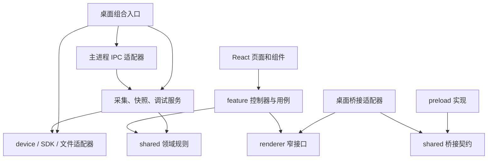
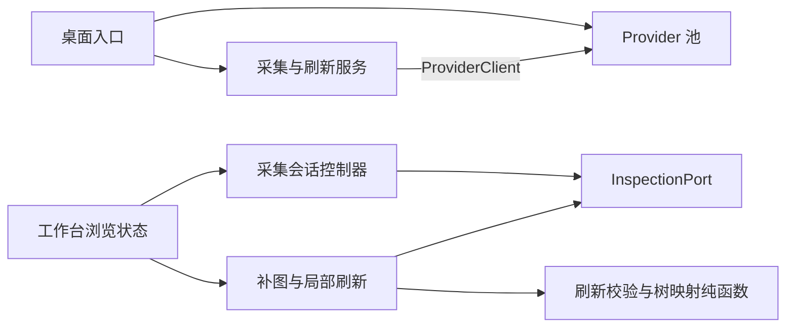
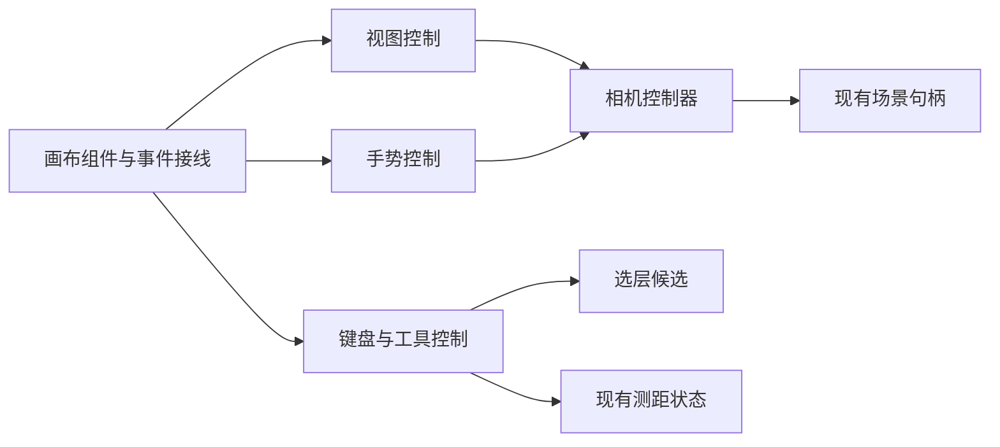
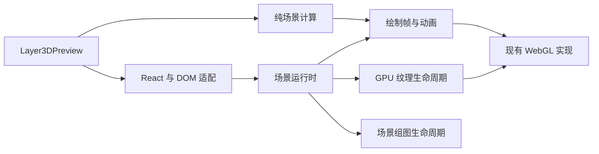

# 架构审查与分阶段重构计划

日期：2026-10-14。状态：**R0 / R1 / R2a / R2b / R3 / R4 / R5a / R5b / R6a 已实施；R6b / R7 / R8 待实施**。

本文保留重构前的审查与分批计划，文末记录各轮实现结果。后续按批次推进，已有功能和展示规则作为基线。

## 1. 结论

项目已有合理的 `src / shared / electron / Android SDK` 分层。需要优先处理的是：**入口再次积累了业务编排，状态和资源的拥有者不够清楚，部分测试绑定了内部代码形状**。

重构目标是让一次修改有明确落点：改采集路由只碰采集服务，改选层手势只碰交互控制器，改窗口关闭只碰资源生命周期。采用接口、纯函数和组合完成这些边界，不引入新的框架依赖。

已有成果继续保留：

- `shared` 的纯逻辑边界和运行时循环依赖检查。
- `projection / framing / scene-camera / motion`、`LayerDemandQueue` 等现有计算与调度模块。
- `shared/workbench-commands.ts` 中的命令名称、快捷键和可用性定义。
- SDK 的 Provider、Session、Tree、Frame、Output 单向职责划分。
- 默认隐藏空层、一键临时查看完整结构，以及当前 Lookin 风格的深度、旋转、边框和选层规则。

这次是在[上一轮架构重构](archive/ARCHITECTURE_REFACTOR.md)基础上收拢新增职责，不重新建立一套平行架构。

## 2. 源码审查结果

下表行号与规模以重构前审查时源码为准。行数只帮助定位审查重点，不作为拆分达标指标。

| 边界 | 当前证据 | 建议与优先级 |
| --- | --- | --- |
| 桌面桥接契约 | [preload.ts](../electron/preload.ts) 第 11 行起实现桥接；[electron.d.ts](../src/electron.d.ts) 第 14 行起另写同一接口 | P1：共享一个契约，业务依赖窄接口，减少两端漂移 |
| 主进程生命周期 | [main.ts](../electron/main.ts) 897 行；第 62–82 行保存多组操作状态，第 345–374、873–897 行分别清理重载、关窗、退出资源 | P1：明确窗口操作和进程资源的所有者，统一销毁入口 |
| 页面业务编排 | [App.tsx](../src/App.tsx) 1101 行；第 333 行起处理导入导出，第 528 行起处理菜单、快捷键和界面定位 | P1：快照用例和命令处理表移入已有 feature 目录 |
| 检查会话 | [useInspectionWorkspace.ts](../src/features/inspection/useInspectionWorkspace.ts) 781 行；第 30 行起混合浏览状态、请求身份与缓存，第 292 行起反复核对 root、epoch、scopeRevision | P1：明确会话转换与请求身份，分开浏览状态和采集状态 |
| 画布与 GPU | [ScreenshotPreview.tsx](../src/components/ScreenshotPreview.tsx) 1128 行，第 701 行起集中处理多种手势；[Layer3DPreview.tsx](../src/features/layers/Layer3DPreview.tsx) 790 行，第 217 行起调度图片和纹理 | P2：分别提取交互控制器、纯场景构建和资源运行时 |
| 采集上下文 | [device/runtime.ts](../electron/device/runtime.ts) 第 7 行向上引用采集选项；[inspection.ts](../electron/capture/inspection.ts) 第 68–158 行传播隐含路由状态，并按错误文案判断部分重试 | P2：显式上下文、类型化路由和错误类别；删除底层对上层选项的依赖 |
| 会话池和自动调试 | [provider-session.ts](../electron/sdk/provider-session.ts) 第 24–47 行在模块加载时创建全局池和回收定时器；[debug-session.ts](../electron/automation/debug-session.ts) 597 行混合目标解析、执行和落盘 | P2：可销毁的会话池；保留调试门面，分离步骤执行和证据输出 |
| 领域事实和 SDK 流水线 | [types.ts](../shared/types.ts) 第 166 行起包含任意属性；[HierarchyCapture.java](../android/inspector-sdk/src/main/java/com/androiduiinspector/sdk/HierarchyCapture.java) 896 行，两个采集入口重复管理编码、写出与清理 | P2/P3：归一图片事实，再按真实线程和资源边界提取共用流水线 |

### 需要先验证的生命周期风险

源码中，应用退出路径未像其他路径一样纳入 `viewRefreshes`，也没有等待返回 Promise 的 `closeProviderSessions()`。这说明清理路径存在差异，**尚未用退出场景证明它一定造成运行故障**。先补“刷新中退出、会话连接中退出”的行为测试；若确认缺陷，独立修复，再做结构迁移。

### 测试自身的重构阻力

[desktop-capture-handoff.test.ts](../tests/desktop-capture-handoff.test.ts) 第 12–30 行从源码提取匿名函数，再通过动态求值注入状态。移动逻辑也会让测试失效。[sdk-architecture.test.ts](../tests/sdk-architecture.test.ts) 检查方法体字符串，样例 [GeometryPipelineProbe.java](../android/sample-app/src/debug/java/com/androiduiinspector/sample/GeometryPipelineProbe.java) 第 421 行起依赖内部反射名称。

这些测试包含有价值的断言。先让同一批断言能够验证真实服务和假依赖，再移除对应的源码提取；依赖方向检查继续保留。SDK 探针只增加调试入口，不为测试扩大正式公共 API。

## 3. 目标结构与依赖规则

继续使用现有目录。下面是依赖方向；跨进程调用经桥接契约连接，不代表 renderer 可以直接导入 Electron 实现。

- `shared` 只包含跨端数据契约和纯规则，不能导入 React、Electron 或 Node 平台 API。不是所有新接口都放到 `shared`；只被一个 feature 使用的接口就留在该 feature。
- React 组件负责布局、事件连接和显示。业务控制器通过参数获得依赖；桌面适配器在应用组装时读取桥接对象，不在模块导入时缓存 `window.electronApi`。
- IPC 适配器负责来源、权限和输入校验，再把有效请求交给业务服务。业务服务不接收 Electron event。
- `electron/main.ts` 保留启动与组装。窗口操作由窗口作用域管理；Provider 池由进程运行时持有。CLI/MCP 若使用同一池工厂，由各自启动入口创建和销毁，不能依赖桌面窗口。
- `device` 的取消、超时等底层需求用自己的小接口表达。采集层负责将上下文传入，不能继续向底层传递整个 `InspectionOptions`。

### 状态与资源归属

| 所有者 | 持有什么 | 结束条件 |
| --- | --- | --- |
| 检查会话控制器 | 快照身份、请求身份、采集结果与补图版本 | 新会话替换、设备切换、卸载 |
| 浏览状态 | 选择、隐藏、展开、聚焦与返回历史 | 按现有快照切换规则重置或映射 |
| 画布交互控制器 | 当前手势、相机、拖动起点、帧调度 | 手势结束、取消、组件卸载 |
| 图层运行时 | GPU 资源、纹理请求、退场资源、渲染帧 | 场景替换、context 丢失或销毁 |
| 窗口操作作用域 | 每类操作的取消器和结束 Promise | 重载、关窗、应用退出 |
| Provider 会话池 | 连接、待回复请求、空闲回收定时器 | 连接回收或进程入口销毁 |

## 4. 设计模式如何落地

下面列出各批次拟新增或调整的边界；首轮已落地的部分见实施结果。每次提取必须迁移真实逻辑并删除旧实现，避免长期保留两份实现。

| 方法 | 落点 | 限制 |
| --- | --- | --- |
| 端口与适配器 | `shared/desktop-api.ts` 为契约唯一来源；preload 用 `satisfies DesktopApi` 检查；`src/platform/desktop-services.ts` 暴露 `InspectionPort / SnapshotPort / MenuPort` | 接口按调用者需要裁剪；保留旧版本可选能力、参数顺序和取消订阅 |
| 命令模式 | `features/workbench/useWorkbenchCommands.ts` 使用现有命令 ID 到处理函数的映射；菜单、快捷键和按钮进入相同处理器 | 不给每个命令建类；现有可用性与互斥规则仍由单一来源判断 |
| 应用服务与存储接口 | `features/history/useSnapshotLibrary.ts` 管导入、保存和历史更新；`snapshot-file-service.ts` 连接现有存储能力 | 只抽已有存储边界，不添加通用 `Repository<T>`，不改快照格式 |
| 显式状态机 | `features/inspection/inspection-session.ts` 表达会话转换，控制器调度补图和局部刷新；`canvas-interaction.ts` 表达空闲、旋转、平移、测距、选层转换 | 多个合法并行请求不能被压成单一 busy；保留 epoch、作用范围和节点映射；高频相机更新仍走 ref 与帧调度 |
| 门面与组合入口 | `electron/desktop/create-desktop-runtime.ts` 装配资源；`window-operation-scope.ts` 收拢取消与等待；图层增加 `buildLayerScene.ts / createLayerSceneRuntime.ts / useLayerSceneRuntime.ts` | 纯场景构建不发请求；运行时负责副作用；保留 `LayerSceneHandle`，不新建万能服务对象 |
| 策略与固定流程 | 采集层增加 `CaptureRunContext / CapturePlan`，显式选择 SDK、DDMS、QML；`DebugSession` 保留门面，提取目标解析、`runStep` 和小型命令处理表 | 路由只有一个决策点；保留回退顺序、单次尝试预算与错误语义；不做插件发现框架 |
| 资源池与组合式流水线 | `createProviderSessionPool` 注入传输、时钟、定时器；SDK 只提取确认相同的有界任务队列、顺序写出和发布机制 | 每个资源只有一个销毁责任人；位图产生时机、格式选择、特殊 View、几何证据和失败清理由各入口显式组合，不用继承模板共用整个采集类 |
| 数据适配 | `shared/node-capture-facts.ts` 从现有节点属性得到类型化的 `NodeCaptureFacts`，供状态、来源、导出规则使用 | 不改落盘 DTO；不在节点上增加容易过期的事实缓存；缺图片不能等同透明 |

`NodeCaptureFacts` 的边界是描述“采集到了什么”，不决定“用户想怎么显示”。默认隐藏空层、临时完整结构等展示偏好仍由展示规则处理。

## 5. 实施顺序与独立交付批次

每批都要可独立审查、验证和回退。前一批完成验收后再迁移依赖它的批次，不将机械移动、行为修复和依赖升级合并。

| 批次 | 具体工作 | 完成条件与依赖 |
| --- | --- | --- |
| R0 基线与测试入口 | 固定合成快照、手势和异步竞态用例；补退出清理特征测试；为最小业务单元建立可注入入口，将原源码提取断言逐项迁到真实实例 | 有旧断言到新断言的对应表；基线差异明确。提取测试入口允许小步迁移，但不顺带重写流程 |
| R1 契约与适配器 | 统一桥接类型；先迁移快照与诊断两个调用面，再覆盖检查接口；收拢 IPC 注册、来源和输入校验，业务仍调用现有实现 | R0 后进行；preload、声明、renderer 使用同一契约；未改变频道、可选能力或返回语义 |
| R2a 生命周期 | 提取窗口操作作用域和桌面组合入口；明确重载、关闭、退出的取消与等待顺序 | R1 后进行；刷新中退出、晚到事件、重复 dispose 均有用例；确认的缺陷单独修复 |
| R2b Provider 池 | 工厂化会话池，移除导入时启动的回收副作用；接入桌面和直接采集脚本。CLI/MCP 复用桌面桥接，不另建池 | R2a 后进行；每个入口负责退出；并发、取消、回收、连接建立中关闭均覆盖 |
| R3 页面编排 | 提取快照用例与命令处理表，让 `App` 以组装为主 | R1 后可与 R2a 并行；导入期间切设备、取消导出、菜单与快捷键走同一规则 |
| R4 检查会话 | 分离浏览状态、采集会话、补图和局部刷新；明确接纳旧/新响应的条件 | R3 后进行；旧响应不能覆盖新快照，局部刷新节点映射和聚焦返回保持原行为 |
| R5a 画布交互 | 提取相机与工具交互控制器，组件保留布局与事件连接 | R4 后进行；旋转、缩放、测距、拖动、双击打开可视子层、输入法和工具互斥均回归 |
| R5b 场景运行时 | 分开纯场景构建和 GPU 生命周期，接回现有需求队列与动画 | R5a 后进行；拾取与绘制使用同一帧，纹理过期和 context 恢复通过，3D 基线无未解释差异 |
| R6a 采集编排 | 显式上下文、类型化路由和错误类别，消除 device 向上依赖；逐入口替换隐含状态 | R2b 后进行；现有回退顺序、身份核对、请求次数和单次尝试预算保持一致 |
| R6b 调试会话 | 在现有会话门面内拆目标解析、步骤执行和证据写出 | R2a 后进行；输入已发送后的未知状态可追踪，停止后等待清理且不再发布过期结果 |
| R7 领域事实 | 用一个适配函数解释图片相关属性，让状态、来源与导出模块消费统一事实 | R5b、R6a 后进行；旧快照兼容，缺图、空图、透明容器和失败状态各自保留 |
| R8 SDK 流水线 | 先稳定调试探针契约，再提取两个入口确认相同的队列、顺序写出和发布机制；保留各自的位图准备与输出策略 | R6a、R7 后进行；完成 SDK/sample 构建及设备探针，对照两个入口的结果、debugCanvas PNG/透明度、Surface/Texture、几何内联与文件输出分支 |

建议第一轮实施只包含 **R0、R1、R2a、R3**。这一轮先建立契约、测试入口和资源归属，不触及当前 3D 分层算法。后续按上表继续，每批结果记录在验收文档。

### 并行开发边界

契约稳定后可分三条职责线：主进程生命周期（R2）、页面与画布（R3–R5）、采集与调试（R6）。R6a 依赖 R2b；R6b 依赖 R2a。SDK 流水线最后单独推进。

每条线使用独立的 Codex 管理工作树，显式指定操作目录。原目录有未提交成果时，以临时 Git 索引建立包含当前源码的共同快照，保留原分支、暂存区和文件；不能从旧远端版本开始。共享契约由一名整合者负责，子代理不同时编辑 `main.ts`、`App.tsx` 或契约文件。

依赖版本相同时可以复用 `node_modules`；源码、构建和测试输出各自隔离。每批只整合确认的文件，核对整合前基线，保留原目录无关改动。仍需开发的工作树保留，已完成且不再需要的使用归档工具处理。

## 6. 必须保持的行为

1. **3D 展示**：默认隐藏空层；完整结构为临时切换，不覆盖保存的默认偏好。保持真实节点边界、当前深度计算、旋转顺序、边框强度和 own/group 过渡；不为“整齐”另造布局或强制组件对齐。
2. **画布一致性**：拾取、测距、遮挡判断、CPU/GLSL/CSS 投影使用一致的几何；动画中也以实际绘制帧为准。隐藏层、选中层和退场层的规则保持一致。
3. **异步身份**：设备、快照、请求、作用范围身份不能省略；局部刷新保留节点 ID 映射；迟到结果不得覆盖新会话。不能为统一不可变状态而复制整棵树，破坏依赖对象身份的检查。
4. **协议与授权**：保留快照版本、缺省字段、IPC 频道和参数顺序、来源验证、只读限制、取消原因以及 `null / reject / error` 的不同含义。
5. **采集与自动调试**：保留原有 SDK/DDMS/QML 回退规则、尝试次数、实时预览取消和操作互斥。不能在响应不确定时自动重放已发出的输入或 Provider 请求。
6. **资源与 Android 线程**：保留 UI 线程采集、Bitmap 所有权、有界编码并发、结果顺序、超时后迟到结果清理、nonce/摘要验证与原子发布；所有销毁入口可重复调用。

## 7. 验证矩阵

测试以风险分组。每批先跑相关用例、类型检查和构建；涉及跨模块契约时再跑完整单测。环境受限的原生或设备验证单独列为未完成，不能用静态通过替代。

| 改动 | 已有验证入口 | 必补场景 |
| --- | --- | --- |
| 依赖与桥接 | `architecture.test.ts`、`desktop-capture-handoff.test.ts`、`snapshot-file.test.ts`；`bun run build` | 单一契约类型检查、来源与参数校验、可选能力缺失、取消订阅 |
| 生命周期与池 | `live-preview.test.ts`、`provider-session-request.test.ts`、`provider-session-transport.test.ts`、`provider-session-timing.test.ts` | 刷新中退出、连接建立中销毁、晚到回复、重复清理、不重放请求 |
| 命令与检查会话 | `workbench-commands.test.ts`；`workbench-entry-checks.tsx`、`inspection-checks.tsx`、`inspection-focus-checks.tsx`、`node-refresh-menu-checks.tsx` | 导入切设备、旧响应、新旧节点映射、菜单和快捷键互斥 |
| 画布与 GPU | `orbit-camera.test.ts`、`preview-viewport.test.ts`、`scene-camera.test.ts`、`layer-demand.test.ts`、`layer-motion.test.ts`、`transparent-picking.test.ts`；`bun run test:coordinates`、`bun run test:layer-images`、`bun run test:dpi` | 默认/完整结构、折叠/展开、过期纹理、context 恢复、退场资源、不同 DPI 与动画拾取 |
| 采集与调试 | `sdk-capture-route`、`capture-session-flow`、`capture-preview-cancel`、`startup-retry`、`sdk-hybrid` 系列；`debug-session.test.ts`、`debug-input.test.ts`、`debug-evidence.test.ts`、`mcp.test.ts` | 请求次数不增加、错误类别映射、输入发出后取消、清理完成前禁止重入 |
| 事实归一与 SDK | 节点状态、图片导出、快照校验与实时更新测试；`sdk-architecture.test.ts`；SDK/sample 构建、pipeline/capture failure/geometry 探针 | 旧字段缺失、透明与缺图区分、超时清理、发布完整性、探针契约兼容；两个入口分别覆盖特殊 View、图片格式/透明度与几何输出 |

视觉和性能基线在实施 R0 时重新采集：固定快照、展开集合、视角、层距、窗口大小及 DPI；比较场景数据和截图。GPU 截图可有抗锯齿差异，但布局、层数、边框、拾取和测距不能有未解释变化。

帧耗时、重建耗时与纹理数量按相同硬件和样例记录；出现稳定回退时阻止合并并定位原因。现有大树基准继续使用，不凭文件变短推断性能提升。CI 使用项目自有合成素材，真实业务画面只放本机忽略目录。

### 方案阶段验证

2026-10-14 在管理工作树执行了 `bun test tests/architecture.test.ts tests/sdk-architecture.test.ts`：**11 通过，0 失败**。这是当前依赖边界与 SDK 架构检查的结果，不代表完成后续重构验收。

方案阶段仅修改文档，未运行完整构建、原生应用或设备测试。下面的首轮实现重新建立并验证了基线。

## 8. 完成标准与不做的事

重构完成应能回答：新增一条采集路径在哪里改；一次请求由谁取消；GPU 纹理由谁释放；菜单和快捷键是否调用同一个用例；一个状态是否来自持久化事实还是界面偏好。

验收标准：

- 入口只组装依赖和连接界面；跨模块调用不依赖隐含全局状态。
- 共享契约只有一份，业务入口接收窄接口；新增代码不用 `any` 绕过边界。
- 每类异步操作有明确拥有者、取消规则和可测试的完成信号；退出测试覆盖相关资源。
- 原有有效断言保留或有对应的行为断言；生产代码不依赖测试目录，不新增依赖环。
- 每批给出文件范围、保留行为、验证结果和回退方式。当前文档与实际目录同步，旧实现和无用途转发壳在迁移完成后删除。

不引入通用事件总线、服务定位器、DI 容器、大型基类或插件系统；不为了模式数量增加抽象；不同时更换依赖版本、快照协议和 UI 规则；不先大规模改目录再补验证。

## 9. 关联文档

- [开发目录](DEVELOPMENT_STRUCTURE.md)：当前实现的入口和依赖方向。
- [测试计划](TEST_PLAN.md)：验证环境与发布要求。
- [验收清单](CORE_ACCEPTANCE.md)：已有功能的实测范围与限制。
- [上一轮架构重构](archive/ARCHITECTURE_REFACTOR.md)：已完成的职责拆分，避免重复建设。

## 10. 首轮实施结果（2026-10-14）

共同快照 `31bd89eb7a54669d6ea87a661243077bfd5bd5ee` 包含原目录未提交源码。主进程与工作台在独立管理工作树并行开发，统一在 `lookin-measurement-finish` 整合；原分支和暂存区保持。

| 范围 | 已落地 | 后续边界 |
| --- | --- | --- |
| R0 测试入口 | 采集 IPC、预览 IPC、退出逻辑改测真实服务和假依赖；增加真实 React hook 的换端口/换设备回包验证 | renderer 部分源码提取测试仍保留，随 R4 对应逻辑继续迁移 |
| R1 端口与适配器 | `DesktopApi` 单一契约；preload 类型校验；App 组装稳定的检查、快照、菜单、诊断接口 | 其他 feature 的桥接访问后续逐项迁移 |
| R2a 应用服务与生命周期 | 私有采集状态进入 `inspection-service`，IPC 单独校验；操作作用域记录取消与完成，桌面运行时统一退出顺序 | Provider 池内部工厂化属于 R2b；普通快照文件存储服务未扩大改造 |
| R3 命令与快照用例 | 历史/文件用例进入 `useSnapshotLibrary`；导出内容由纯函数生成；按钮、菜单、快捷键共用分发表和可用规则 | App 仍组装设备和 UI，不要求本轮将所有功能抽空 |

代码定位：`electron/main.ts` 897 → 722 行，`src/App.tsx` 1101 → 857 行。行数只用于说明职责迁移，不代表性能改善。

本轮确认并处理的边界：

- 刷新中退出会取消并等待结束，Provider 关闭也被等待；重复退出不会提前放行，清理失败会报告并继续完成其他清理。
- 被新请求替换的旧任务仍归窗口所有，不能因 Map 覆盖而漏等；预览验证与调试启动的在途工作也登记。
- 运行时替换检查接口会释放旧订阅、取消旧请求并清除忙碌状态；旧接口和旧设备的迟到回包不能恢复旧内容。
- 首页切换设备使待导入文件失效；菜单、快捷键和按钮使用相同门禁，输入法组合事件不触发快捷命令。

### 断言迁移和基线差异

| 原入口或假设 | 现在如何验证 |
| --- | --- |
| 从 main 匿名处理器抽源码，注入可写 Map | `createCaptureHandlers` + `createInspectionService`；通过真实在途请求建立互斥状态 |
| 抽取 before-quit 函数 | `createDesktopRuntime` + `createWindowOperationScope`；deferred 验证顺序、重复退出、同步/异步失败 |
| 抽取 live-preview-start/stop | `createLivePreviewHandlers` 的真实实例和可控设备验证 |
| renderer 回调抽取缺少新增 ref | 保留原断言并补齐现有 ref；另用真实 hook 覆盖端口和设备切换 |
| 用 Set 引用相等、SVG 内部路径识别树行为 | 验证展开成员、实际行与图标 mask 资源；对应当前已有 UI |
| 首页仍有“打开快照”按钮 | 通过现有菜单入口打开，继续验证取消与迟到回包 |
| 程序事件绕过禁用的设备选择器 | 先断言按钮/菜单均拒绝禁用动作，再走取消→切设备；直接替换采集由真实 hook 单独验证 |

初始全量基线为 1404 通过、13 失败（7 个错误记录），集中在过时的采集源码提取工装；未将它标记为通过。修正工装并完成迁移后，整合全量为 **1434 项 / 197 文件，0 失败**，类型检查和完整构建通过。

实际 React 工作台通过树、属性、检查会话和自动调试交接回归；新增快照控制器在 1440×900、1024×768、900×680 三档验证取消、失效、卸载、导出重入、历史时间与实时选中。实际产品 main/preload/renderer 的原生菜单、焦点、授权/撤销与繁忙规则通过。坐标结果及同步记录见[验收清单](CORE_ACCEPTANCE.md#architecture-round1-acceptance)。

所有证据位于整合目录 `.benchmarks/architecture-round1-20261014/`；初始失败日志保留。本轮使用合成数据、隔离配置和假设备；没有真机操作，没有更新安装包。当前 3D 分层、空层默认隐藏、完整结构开关、边框与拾取算法源码未改。

## 11. 第二轮实施结果（2026-10-14）

共同快照 `32be9958d8dc4959a03aca3c03f1bcf409bdd60d` 含原目录首轮成果及未提交源码。Provider 池、调用链和检查会话在独立管理工作树并行开发，在 `lookin-measurement-finish` 整合。

| 范围 | 具体边界 | 使用方式 |
| --- | --- | --- |
| R2b Provider 池 | 工厂创建私有连接、请求与回收资源；注入 ADB、socket 和时钟 | `main.ts` 创建一个实例，采集与调试只依赖 `ProviderClient`；直接采集脚本自己创建并在 `finally` 销毁 |
| R4 采集会话 | `inspection-session.ts` 拥有请求身份、预览/结果接纳、取消与进度；`useInspectionSession.ts` 负责 React 订阅和计时器 | 控制器通过采集开始、预览、完成和外部快照等事件更新浏览状态，避免传递一组可写 setter |
| R4 补图与刷新 | `useSnapshotAugmentation.ts` 拥有局部刷新；`group-image-cache.ts` 复用同源请求；纯函数校验刷新并计算选中/展开映射 | 同时验证接口生命周期、源快照、节点对象和请求归属；相同请求号内换树仍拒绝旧回调 |
| R4 浏览状态 | `useInspectionWorkspace.ts` 保有选中、展开、聚焦/隐藏、查看历史与菜单语义 | 组合采集与补图/刷新模块；不为缩短文件继续拆散相关状态 |

这一轮使用工厂、依赖注入、端口适配和显式控制器来明确所有权，没有增加全局事件总线或通用状态框架。

生命周期规则：

- `releaseAll()` 先阻止新请求，取消并等待当前任务和连接释放，结束后可复用。`dispose()` 永久销毁并清除定时器，重复调用共享同一完成信号。
- 建连中销毁会等待迟到的转发端口并清理；旧连接的晚到事件不能删掉新连接。探测、兼容启动、二次核验和 content 回退顺序保持，业务失败不重放。
- 检查接口替换或卸载后，旧采集/清空/打开回调失效，不能取消新页面的刷新。订阅和计时器随所属控制器释放，支持 React 重新连接。
- 补图绑定源快照与节点对象，换树、失效或卸载后旧结果不进入新缓存。局部刷新保留节点映射、聚焦返回和默认折叠规则。

测试迁移：`capture-session-flow` 改为真实池工厂与可控依赖；renderer 采集交接、补图缓存改测真实控制器和缓存，移除对应源码抽取。真实 React 工装覆盖端口替换、同端口换设备、保留旧回调及卸载；架构门禁限制 Provider 运行时组装入口并检查导入副作用。

完整结果与证据见[第二轮验收](CORE_ACCEPTANCE.md#architecture-round2-acceptance)。下一批为 R5a 画布交互与 R6a 采集编排；R5b、R6b、R7、R8 继续按依赖顺序推进。当前 3D 分层、默认隐藏空层与完整结构开关的算法源码未改。

## 12. 第三轮实施结果（2026-10-14）

本轮完成 R5a 画布交互。共同快照 `3c552552ea8857115d9469a559fde7d0b4bbeab6` 包含原目录此前成果；实现、回归和审查分别使用独立管理工作树，在 `lookin-measurement-finish` 整合。R5b 的场景构建与 GPU 生命周期留到下一批。

| 模块 | 拥有的状态和职责 | 边界 |
| --- | --- | --- |
| `ScreenshotPreview` | 组件布局、显示偏好、临时完整结构和事件接线 | 组合下列控制器；不再拥有相机动画或拖动状态机 |
| `canvas-camera` | 当前相机、目标值、绘制与动画帧队列 | 工厂注入时钟、调度和绘制能力；拖动和动画的每一帧不更新 React 状态 |
| `useCanvasView` | 模式、缩放、画布适配、聚焦返回和滚动恢复 | 把 DOM、场景句柄和 React 状态接到相机控制器；集中清理延迟工作 |
| `useCanvasInteraction` | 按下时的拾取结果、拖动、右键、双击和指针捕获 | 只拥有一次手势；取消、失去捕获和卸载有明确出口 |
| `useCanvasKeyboard` | 快捷键、输入法门禁、Escape 优先级、失焦处理 | 稳定注册监听，转发当前处理器；保持编辑框和弹层的原有规则 |
| `useCanvasQuickSelect` / `useCanvasHover` | 当前候选、预览、分页、确认和悬停桥接 | 候选绑定源树与场景上下文，过期回调不能作用于新页面 |
| `useCanvasTools` | 缩放/设置/帮助弹层与选层、测距的互斥入口 | 固定 A/B 和测量结果继续由现有 `useLayerMeasurement` 拥有 |

这里使用工厂、依赖注入、适配器和组合控制器：每个模块负责自己的状态与清理，通过实际需要的窄接口协作。组件缩短是职责移动的结果，不作为性能提升的证据。

保留按下时实际帧拾取、4px 拖动门槛、右键点击与拖动区分、双击打开、固定测距、聚焦返回、默认隐藏空层和完整结构切换。分层、投影、边框、纹理及 GPU 算法不在本轮修改范围。

验证使用真实相机工厂和实际 React 组件，不从 `ScreenshotPreview` 文本提取函数。取消后的旧动画帧会被主动再次递送，以确认失效检查生效；原缩放锚点、工具互斥、固定测距和坐标工装继续执行。旧测试中关于空层、默认相机和固定缩放的过时假设按实际契约修正，原失败与修正依据一并保留。

完整结果、修正说明和证据见[第三轮验收](CORE_ACCEPTANCE.md#architecture-round3-acceptance)。后续按依赖推进 R5b、R6a/R6b、R7 和 R8。

## 13. 第四轮实施结果（2026-10-14）

本轮完成 R5b。共同快照 `1d79673f98a12f296349748447a5d46ca02ee97d` 包含此前未提交成果；纯场景、运行时和回归分别在三个独立管理工作树开发，再整合到 `lookin-measurement-finish`。

| 模块 | 职责与资源归属 |
| --- | --- |
| `Layer3DPreview` | 组合模型和运行时，保留 memo、适应画布、悬停标签、测距和场景句柄 |
| `scene-model` | 计算布局、基础平面、高亮、framing 和 presentation；只接收已解析纹理信息，不修改缓存或 GPU |
| `scene-frame-runtime` | 保存实际绘制相机、平面和投影；管理折叠/反向动画、回退计时器及父子画面交接 |
| `scene-texture-runtime` | 管理串行纹理需求、解码、透明区域扫描、像素预算和回收；迟到图片按资源身份丢弃并释放 |
| `scene-group-runtime` | 管理当前树、截图和会话的组图请求；GPU 丢失时暂停发布，恢复后沿用同一场景的结果 |
| `scene-runtime` | 协调上述运行时，拥有渲染器的创建、丢失、恢复与幂等销毁，以及整屏图片加载 |
| `scene-runtime-ports` / `useLayerSceneRuntime` | 前者注入图片、GPU 与调度能力；后者连接 React、DOM 观察器和卸载清理 |

使用组合、门面和依赖注入明确资源所有权。纯计算与有状态运行时分开，不增加框架、全局事件总线或平行状态库。原分层、投影、着色器和需求队列算法继续复用；默认隐藏空层和一键完整结构保持原规则。

关键约束：拾取、快速选层和测距读取实际已绘制帧；选择/悬停只更新高亮，不重算布局或上传同一纹理；晚到组图不回写旧相机；根或会话更新不重载未变整屏图；GPU 未就绪时仍可调度组图。销毁后即使旧回调被再次递送，也不能绘制、上传或发布结果。

新增真实渲染回归复现了旧代码的一个缺陷：同根换截图发生在透明区域扫描中时，旧扫描失效，但同名已上传纹理被新队列视为完成，画面可能一直只剩边框。现在销毁纹理运行时时会移除其未完成扫描对应的纹理，新需求重新加载；已完成纹理仍可复用。旧失败与修复后的像素结果分别保留。

完整验证结果与证据见[第四轮验收](CORE_ACCEPTANCE.md#architecture-round4-acceptance)。下一批为 R6a：显式采集上下文、类型化路由和错误分类；R6b、R7 和 R8 继续按依赖推进。

## 14. 第五轮实施结果（2026-10-14）

本轮完成 R6a。共同快照 `6ab68019de3f0c5595b0e7ed49324830437bcd5c` 包含此前未提交成果；上下文迁移、采集编排和回归在三个独立管理工作树并行，再整合到 `lookin-measurement-finish`。

| 边界 | 职责 |
| --- | --- |
| `CaptureRunContext` | 显式携带采集选项、请求锁定的组件、当前尝试路由及阶段信号；重试共享组件身份，重新建立路由；不复制控件树 |
| `CapturePlan` | 保留用户的自动/SDK/DDMS 偏好；区分 SDK 优先预判和验证后的取图切换；实际取图路线为 `sdk / ddms` |
| `CaptureFailure / CaptureError` | 在兼容边界解释旧错误，内部用类型化失败决定重试和回退；外部仍返回原快照格式与中文提示 |
| `createInspectionRunner` | 注入设备与图片边界；保留就绪等待、native/QML 分流、整页采集、重试预算和最终核验 |
| `sdk-tree-verification` | 复用本次合并采集的身份凭据，或执行独立读树前后核验；显式继承当前取图阶段的截止时间 |
| `command-context` | 底层仅继承 `AbortSignal`；采集策略不再存入异步局部变量，`device` 不再向上引用 `capture` |

这里使用组合、策略、窄端口和类型化结果。原生/QML 的识别仍由整页编排负责，没有增加策略注册表或通用流程框架。局部刷新、QML、SDK 读树、设备操作、诊断和直接脚本同步迁移；Provider 池仍独立拥有连接与销毁责任。

保持的关键语义：小页面先取 DDMS 属性，验证 SDK 能力后才切换取图；合并树身份已核验时不重复查询；发布后的 SDK 树变更不能重放整页请求；就绪等待和启动重试各自使用原预算；命令取消后仍清理已分配的转发。

测试从源码片段抽取迁到真实采集入口、身份核验、属性交接和预览边界。审查中特别覆盖：并发请求隔离、重试路由重置、SDK 验证继承取图阶段信号，以及核验等待期间迟到的树通知诊断。

另外修复一个在旧共同快照真实入口复现的取消缺陷：最终 SDK 窗口核对期间取消，旧逻辑会返回成功快照并附带警告；现在返回原始取消原因。普通窗口或 PID 不匹配仍按原规则保留独立画面并警告。这是单独记录的行为修正，不算纯重构等价。

完整结果和边界见[第五轮验收](CORE_ACCEPTANCE.md#architecture-round5-acceptance)。下一批是 R6b：拆分自动调试会话的目标解析、步骤执行和证据写出。R7、R8 按依赖继续推进。
