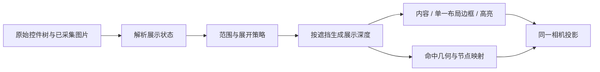

# Lookin 3D 层级源码研究与改造方案

日期：2026-10-13。状态：**P0、P1 第一阶段和 P2 主要改动已实现**。源码研究与实施前分析保留在下文；实际落地范围及验证见第 8 节。

## 1. 建议先做什么

**先统一图层的内容、布局边界和点选范围，再减少重复结构轮廓，最后调整默认展开和镜头衔接。**

Lookin 的层次感来自一套配合：按遮挡排层、展开时显示自身图、折叠时显示整组图、单一布局边框、独立选中蒙层，以及有选择的默认展开。我们已经具备其中大部分基础，主要缺口在展示语义和结构密度。

第一批已完成 **P0：统一画面状态、每个控件只画一条普通布局边框、明确点选规则**，并接入 P1 轮廓精简及组件展开、P2 视图衔接。沿用此前已经调细的边框作为视觉基线。

## 2. 源码依据与调用链

本次直接阅读固定版本源码，并从官方仓库重新下载核对关键文件：

| 来源 | 固定版本 | 本次用途 |
| --- | --- | --- |
| [Lookin 客户端](https://github.com/hughkli/Lookin/tree/95e30fdcc8151092678387c5262bce790a0d9530) | `95e30fdcc8151092678387c5262bce790a0d9530` | 展示树、排层、SceneKit 节点、镜头和交互 |
| [LookinShared / LookinServer](https://github.com/QMUI/LookinServer/tree/985e8afe77aa2f3fab599da4f9882f6e43eed919) | `985e8afe77aa2f3fab599da4f9882f6e43eed919` | 客户端 [Podfile.lock 实际锁定的依赖](https://github.com/hughkli/Lookin/blob/95e30fdcc8151092678387c5262bce790a0d9530/Podfile.lock#L32-L36)，核对模型和自身／整组截图 |
| 本项目 | 2026-10-13 当前未提交源码，包含本轮边框调整 | 与真实 Android 快照对照；不能只看 Git HEAD |

以下区分**源码事实**、**本项目问题**和**拟议设计**。Lookin 的 SceneKit 场景单位与我们的屏幕像素不同，数值不直接照搬。

### 2.1 数据、展开与截图

调用链：`LKHierarchyDataSource` → `LookinDisplayItem` → `LKPreviewController` → `LKPreviewView` → `LKDisplayItemNode`。

- **源码事实：** 完整树和当前展开的树分开保存。祖先收起后，后代的 `displayingInHierarchy` 变为 false；预览中的内容和边框随之隐藏。[展示状态传播](https://github.com/QMUI/LookinServer/blob/985e8afe77aa2f3fab599da4f9882f6e43eed919/Src/Main/Shared/LookinDisplayItem.m#L274-L291)、[预览可见性](https://github.com/hughkli/Lookin/blob/95e30fdcc8151092678387c5262bce790a0d9530/LookinClient/Static/Preview/LKDisplayItemNode.m#L131-L168)。
- **源码事实：** 可展开且已展开的控件使用 `soloScreenshot`，折叠控件和叶子使用 `groupScreenshot`。端侧自身图通过暂时隐藏子层后绘制取得；整组图包含子层。[图片选择](https://github.com/hughkli/Lookin/blob/95e30fdcc8151092678387c5262bce790a0d9530/LookinClient/Base/Category/LookinDisplayItem+LookinClient.m#L57-L62)、[端侧截图](https://github.com/QMUI/LookinServer/blob/985e8afe77aa2f3fab599da4f9882f6e43eed919/Src/Main/Server/Category/CALayer+LookinServer.m#L61-L148)。
- **源码事实：** 默认展开等级为 3；超过 300 个节点时，新计算的等级最高取 2。它还会优先折叠常用控件内部、非主窗口、导航栏等，等级 2 围绕页面控制器展开 2～3 层，并优先保留旧对象的手动状态。[默认值](https://github.com/hughkli/Lookin/blob/95e30fdcc8151092678387c5262bce790a0d9530/LookinClient/Manager/LKPreferenceManager.m#L141-L146)、[大树限制](https://github.com/hughkli/Lookin/blob/95e30fdcc8151092678387c5262bce790a0d9530/LookinClient/Hierarchy/LKHierarchyDataSource.m#L217-L229)、[展开策略](https://github.com/hughkli/Lookin/blob/95e30fdcc8151092678387c5262bce790a0d9530/LookinClient/Hierarchy/LKHierarchyDataSource.m#L296-L512)。

**启示：** 清楚的初始视图需要控制一次展示多少结构。Android 应依据自己的采集事实和组件信息制定规则，不能复制 UIKit 类名。现有 SDK 自身图、原生分支图和本地合成继续复用。

### 2.2 Z 轴是怎样排出来的

**源码事实：** `LKPreviewView` 按扁平数组顺序处理控件。当前可展示控件与前面的矩形比较，找到相交对象的最大 `previewZIndex`，再加 1；没有相交对象时取 0。折叠隐藏的后代继承父层深度。比较会考虑隐藏层开关，使用的是 `frameToRoot` 矩形，而非图片不透明像素。[排层与相交比较](https://github.com/hughkli/Lookin/blob/95e30fdcc8151092678387c5262bce790a0d9530/LookinClient/Static/Preview/LKPreviewView.m#L197-L256)。

之后再把整数层号转成展示位置：

- 3D 间距为 `0.1 + zInterspace × 0.7`；偏好默认 0.22，所以默认场景间距为 0.254。
- 整个深度范围居中，让旋转轴穿过堆栈中部。
- 同层对象按顺序增加极小偏移，避免完全共面。
- 所有位置更新放在同一个 `SCNTransaction` 中，服务于展开／折叠动画。

依据：[深度映射与批量事务](https://github.com/hughkli/Lookin/blob/95e30fdcc8151092678387c5262bce790a0d9530/LookinClient/Static/Preview/LKPreviewView.m#L155-L193)、[间距默认值](https://github.com/hughkli/Lookin/blob/95e30fdcc8151092678387c5262bce790a0d9530/LookinClient/Manager/LKPreferenceManager.m#L120-L130)。

**本项目已有：** [buildLayerOverview](../shared/layer-layout.ts) 已按相交矩形排层，并按 Android 绘制顺序处理兄弟节点；[Layer3DPreview](../src/features/layers/Layer3DPreview.tsx) 也已经围绕整体中心旋转。继续沿用这两个基础。当前总览对重复空边界使用 0.28 倍间距，但每层仍参与展示；这与“减少重复轮廓”是两件事。

### 2.3 一个控件的内容、边框和高亮分开画

**源码事实：** 每个 `LKDisplayItemNode` 包含三个子节点：

| 子节点 | 作用 | 关键实现 |
| --- | --- | --- |
| content | 显示自身图或整组图 | 双面平面、恒定材质，图片颜色不随灯光改变 |
| mask | 选中／悬停的蓝色蒙层 | 相对内容前移 0.001，只在需要时挂载 |
| border | 布局矩形四条线 | 相对内容前移 0.002，使用线段几何 |

绘制顺序按 `index × 10`、`+1`、`+2` 区分。边框几何直接来自内容平面的布局矩形；这条预览路径没有为透明裁切后的像素区域再增加第二条普通边框。[节点构成与顺序](https://github.com/hughkli/Lookin/blob/95e30fdcc8151092678387c5262bce790a0d9530/LookinClient/Static/Preview/LKDisplayItemNode.m#L32-L128)、[布局尺寸](https://github.com/hughkli/Lookin/blob/95e30fdcc8151092678387c5262bce790a0d9530/LookinClient/Static/Preview/LKDisplayItemNode.m#L239-L266)。

普通边框按深浅主题使用灰色、alpha 0.6；选中／悬停改为蓝色。蒙层强度独立于边框：选中有 0.35／0.6／0.85 三档，悬停更轻。源码使用线段几何，没有显式规定可跨渲染器照搬的 CSS 线宽。[颜色与蒙层](https://github.com/hughkli/Lookin/blob/95e30fdcc8151092678387c5262bce790a0d9530/LookinClient/Static/Preview/LKDisplayItemNode.m#L174-L231)。

**本项目差异：** [webgl-renderer 的 contentPlane / preparedPlanes](../src/features/layers/webgl-renderer.ts) 裁去图片透明外沿后，既保留原范围轮廓，又给裁切后的内容加边框。缩略文字、头像和带透明留白的控件可能出现两种框；图片模式的选中／悬停也经过同一裁切流程，而仅边框模式使用原始平面，范围含义随模式变化。

### 2.4 镜头、命中和状态更新

- **镜头：** Lookin 使用透视相机，固定相机 Z 为 34，旋转和平移舞台；缩放通过 `20 + scale² × 730` 改焦距。切回 3D 会恢复前次角度，水平旋转与自由旋转分开处理。[相机创建](https://github.com/hughkli/Lookin/blob/95e30fdcc8151092678387c5262bce790a0d9530/LookinClient/Static/Preview/LKPreviewView.m#L48-L60)、[变换与焦距](https://github.com/hughkli/Lookin/blob/95e30fdcc8151092678387c5262bce790a0d9530/LookinClient/Static/Preview/LKPreviewView.m#L293-L340)、[模式切换](https://github.com/hughkli/Lookin/blob/95e30fdcc8151092678387c5262bce790a0d9530/LookinClient/Static/Preview/LKPreviewController.m#L309-L334)。
- **命中：** SceneKit 查询带 selectable 标记的最近几何节点。只有内容节点承载可选标记，边框和蒙层不争抢点击。快速选择会临时开放部分折叠后代的命中，再展开目标路径。[命中入口](https://github.com/hughkli/Lookin/blob/95e30fdcc8151092678387c5262bce790a0d9530/LookinClient/Static/Preview/LKPreviewView.m#L275-L285)、[可选状态](https://github.com/hughkli/Lookin/blob/95e30fdcc8151092678387c5262bce790a0d9530/LookinClient/Static/Preview/LKDisplayItemNode.m#L131-L168)、[点击后展开路径](https://github.com/hughkli/Lookin/blob/95e30fdcc8151092678387c5262bce790a0d9530/LookinClient/Static/Preview/LKPreviewController.m#L406-L422)。该入口没有逐像素 alpha 命中逻辑。
- **更新：** 节点可复用；属性变化分别更新几何、图像颜色和可见性。展开／布局变化触发排层，选中／悬停主要更新表现。[节点复用](https://github.com/hughkli/Lookin/blob/95e30fdcc8151092678387c5262bce790a0d9530/LookinClient/Static/Preview/LKPreviewView.m#L102-L141)、[属性分派](https://github.com/hughkli/Lookin/blob/95e30fdcc8151092678387c5262bce790a0d9530/LookinClient/Static/Preview/LKDisplayItemNode.m#L236-L282)。

**本项目取舍：** 保留 WebGL、已有透视投影、按实际角点适应画布、遮挡排序和 220ms 折叠动画。借鉴状态分工与操作连续性，不为模仿外观迁移 SceneKit，也不照搬其命中实现。

## 3. 实施前画面为什么仍显得杂

对 10/13 21:33:00 保存的快照做了离线复算。条件：全部展开、隐藏不可见控件、层间距 128、上限 512，包含根参考层。仅输出数量，不导出页面内容。

| 指标 | 实际值 | 说明 |
| --- | --- | --- |
| 完整树 | 1355 个控件 | 树数量不等于画布数量 |
| 画布记录 | 239 层 | 238 候选＋1 根参考层，未触发截断 |
| 内容／轮廓记录 | 101／138 | 轮廓多于有画面的层 |
| 已确认自身空图 | 58 层 | 与结构性不绘制、采集失败分开计数 |
| `skip-draw` 且无自身图 | 79 层 | 均进入了当前强制轮廓判定 |
| 强制轮廓 | 80 层 | 其中 79 层属于上一行 |
| 相同布局矩形 | 最多 23 层重合；35 组重复范围 | 不是所有这些层都可合并，需要检查关系和来源 |
| 展示 Z 跨度 | 8432.64 | 约为截图宽度 1080 的 7.8 倍；这是人工展开距离，不是设备真实 Z |

由源码和复算可以确认四个问题：

1. **边框职责重复。** 透明外沿裁切后会额外产生内容边框，布局边框和内容边框同时出现。
2. **强制边框判断过宽。** [scenePlanes](../src/features/layers/Layer3DPreview.tsx) 使用 `isCollapsed || !layerImageEmpty`，把不少 `skip-draw` 结构节点也归为必须显示；而 [node-presentation-status](../shared/node-presentation-status.ts) 已能区分结构、空图、失败和缺图。
3. **重复结构仍很密。** 62 条记录被标记为 compact，但缩小间距后仍各自描边。当前 [默认树展开](../shared/tree-collapse.ts) 为全部展开，进一步放大这个现象。
4. **内容裁切同时影响点击范围。** 当前裁切后的平面被放入点选列表，布局轮廓却不可命中；普通结构轮廓又按整块矩形命中。视觉边界、可点范围和高亮范围需要统一约定。

这些是本项目的具体改造点。`skip-draw` 仍表示采集链路报告的结构状态，不能把它改写成“像素检测全透明”，也不能据此删除树节点或子层。

## 4. 设计与分期

### P0：明确一层的内容、边框和点击范围

建立共用的展示结果，复用现有画面状态解析器：

| 字段 | 负责什么 |
| --- | --- |
| layoutRect | 控件布局范围，用于属性、测距、布局轮廓和选中高亮 |
| contentRect + sourceRect | 已采集图片的绘制范围和纹理采样；允许保留透明外沿优化 |
| visualState | 已采集、已确认空图、结构不绘制、缺图／失败、折叠整组图 |
| outlinePolicy | 普通、必须提示、暂不绘制；不靠缺少一个布尔值推断 |
| hitPolicy | 内容区域、边缘、仅树中可选；仍关联原始 nodeId |

`layerCapturePlacement` 只描述图片实际放置位置，不能覆盖控件的布局范围。图片裁切和布局边框分别从各自字段生成。

具体规则：

- 每个展示控件最多一条**普通布局边框**；裁切后的内容不再自动加框。选中／悬停用独立高亮，避免同一条边重复混合变粗。
- 普通边框沿用当前细线基线，统一从主题参数取得颜色。关闭普通轮廓时，已确认空图和结构节点应服从开关；真正缺图、失败及无法展示的折叠组保留定位提示。
- 对同时存在的状态设明确优先级：失败／匹配不明需要提示；自身已采集图优先显示；结构标记不覆盖已有有效图；折叠分支单独判断整组图是否可用。
- 普通点击先取最前方可见内容，再考虑未被前景内容遮住的结构边缘。空容器内部不拦截内容；它们仍可从树选择，选中后显示完整布局边界。
- 边缘命中容差与视觉线宽独立，初始复用现有约 6 CSS px 容差；旋转、背面和共面对象继续按当前绘制顺序消歧。
- 本批保留现有矩形内部透明孔的处理方式；逐像素穿透另行评估。候选快速选择、测距和原图导出继续使用原始坐标与既有来源校验。

### P1：减少重复结构，再提供合适的初始展开

**本项目改编，Lookin 没有这里提出的祖先链轮廓合并算法。**

1. 在现有「3D 设置」中增加“常规／完整结构”的显示选择，不增加顶栏常驻按钮。常规模式降低重复结构噪声，完整结构保留逐层查看能力。
2. 首版只合并**连续祖先链、布局范围相同、来源明确为空图或结构不绘制、没有自身有效画面**的重复普通轮廓。裁剪、放置变换和不透明度语义不同的层，以及缺图、失败、折叠分支、真实背景不合并。不同分支即使矩形相同也不直接合并。
3. 第一阶段只合并描边，沿用原有深度与 nodeId，降低回归风险。下一阶段再验证紧凑结构组的展示间距：逻辑排层和展示距离分开计算；不得把多层背景压到同一张内容平面。
4. 组内节点保留树入口；选中任一节点可显示自身布局高亮，其他节点和相机不因选中而换位置。需要逐层查看时切到完整结构，而非每次点击自动撑开整组。
5. 默认展开采用可解释的组件规则：有明确组件元数据或用户配置时，沿用现有折叠机制展示整组图；没有可靠信息时保留当前展开，不按类名含 “Layout” 或 “ViewGroup” 猜测。
6. 提供一次性的“按组件查看”，与现有“全部”及分支聚焦配合。先验证新快照的初始体验；历史快照、手动展开、搜索临时展开和聚焦返回都有独立恢复规则。

### P2：让视角切换与展开更连续

- 正视、层叠、展开三个入口继续放在 3D 设置中；2D／3D 往返恢复此前观察角度。
- 选中、悬停、主题和普通边框开关只更新绘制状态；将几何排层从选中状态更新中拆出，避免同一棵树重复计算排层。
- 延用现有动画中断和图像缓存机制；折叠时内容、边界和点选一起切换，不出现旧图仍可点的短暂状态。
- 显式“适应画布”始终包住当前展示范围；手动观察过程中不因图片到达或高亮变化突然缩小整个场景。密集场景先靠结构策略和分支聚焦改善可读性，再比较角度与层距方案。

## 5. 实施顺序与文件边界

| 批次 | 改动入口 | 交付条件 |
| --- | --- | --- |
| P0-1 状态与边框 | `shared/node-presentation-status.ts`、`presentation.ts`、`Layer3DPreview.tsx`、`types.ts`、`webgl-renderer.ts` | 空／结构／缺图语义一致；一层一条普通布局边框 |
| P0-2 命中一致性 | `projection.ts`、`Layer3DPreview.tsx`、`quick-select.ts` | 内容优先，结构按边缘命中，原坐标和遮挡一致 |
| P1 结构展示 | `shared/layer-layout.ts`、`shared/tree-collapse.ts`、`ScreenshotPreview.tsx`、`shared/appearance.ts`、`src/features/layers/appearance.ts` | 常规／完整结构可逆；连续祖先链之外不误合并；选中不改深度 |
| P2 交互收口 | `ScreenshotPreview.tsx`、`shared/orbit-camera.ts`、`motion.ts` | 切换和折叠连续，几何更新与高亮更新分离 |

`presentation.ts`、`types.ts`、`projection.ts`、`motion.ts`、`quick-select.ts`、`Layer3DPreview.tsx` 和 `webgl-renderer.ts` 均位于 `src/features/layers/`；`ScreenshotPreview.tsx` 位于 `src/components/`。P0-1 → P0-2 → P1 → P2 依次落地；每批可单独验收、回退。后续并行开发时，几何／状态契约先统一，再按展示计算、渲染命中、工作台交互划分独立工作树。

## 6. 验收方式

| 场景 | 必须满足 |
| --- | --- |
| 白底、深底、透明留白的文字／头像 | 一个控件不再出现内容框＋布局框；高亮对应真实布局；输出图片逐像素不变 |
| 空图、`skip-draw`、缺图、失败、折叠后缺组图 | 状态分类与属性栏一致；普通轮廓开关不被结构节点绕过；真正缺图仍可定位 |
| 当前最多 23 层同范围的密集样本；另造祖先链与兄弟层样例 | 合并仅作用于满足条件的祖先链；真实背景、兄弟遮挡顺序和树节点完整保留 |
| 内容、透明边缘、结构边缘、前景遮挡、背面旋转 | 普通选择、悬停、右键、快速选择使用一致的目标；透明孔按既定规则处理 |
| 折叠／展开、搜索、聚焦、连续点击切换 | 选择和查看范围可恢复；无重复图片、旧命中、相机跳动和迟到图片污染 |
| 1440×900、960×700、650×760；100%／125%／150% | 图层、设置和适应画布可用；同时检查深浅主题。页面缩放与物理屏幕 DPI 分别记录 |

继续使用现有 `layer-layout`、`layer-appearance`、`layer-display-mode`、`layer-motion`、`quick-select` 测试和 `test:coordinates`，针对上述行为补断言，不为视觉常量编写镜像测试。

固定 512 层压力样例记录 CPU 提交时间、draw calls、纹理上传和内存，并与实施前同机基线比较；不把提交耗时换算成屏幕 FPS。当前快照的 239 层用作离线视觉回看，再补项目自有样例作为可分享的回归数据。

每批保存相同快照、相同角度／倍率的前后对比；记录普通边框数、重复范围数和命中结果。**P0 不以删减控件数量为目标；P1 的降噪必须可切回完整结构。**

## 7. 范围与调研留档

本方案针对桌面 3D 层级展示，复用现有 Android 采集、快照和原图输出能力。端侧截图实现只作为来源语义参考；本轮无需扩展采集协议、引擎或设备操作。

本次未运行或修改 Lookin 应用；结论来自固定版本源码与本项目离线复算。SceneKit 最终抗锯齿、实际线宽及跨设备手感仍需后续实机对照，文中的数值只用于解释源码。

调研证据在管理工作树 `.benchmarks/lookin-layer-source-plan-20261013/`：官方源码校验清单、`Podfile.lock` 对照、离线复算脚本及 `snapshot-metrics.json`。其中快照指标只有数量，不包含用户名、设备标识或截图内容；上游代码留在忽略目录，不进入本项目源码。

## 8. 实施结果

### 已落地的行为

| 改动 | 用户可见的结果 |
| --- | --- |
| 展示状态统一 | 已确认空图、结构不绘制服从普通轮廓开关；缺图、失败仍保留定位边框 |
| 内容与布局分离 | 图片透明外沿可以裁切，但只在原布局范围画一条普通边框；选中／悬停使用同一布局范围，避免重复叠色 |
| 点击与画面一致 | 内容优先；纯结构只按可见边缘选择，空白内部不挡住后面的控件；树中仍可选择完整节点 |
| 常规／完整结构 | 在「3D 设置 → 结构轮廓」切换；常规只合并安全的连续祖先链轮廓，完整模式可恢复；不改变节点和深度 |
| 按组件查看 | 层级树增加「按组件」；按明确的 Android 平台组件全名和用户配置收起内部层级，保留选中路径 |
| 默认规则兼容 | 新用户启用标准组件规则；旧的已保存规则保持原行为。偏好设置可关闭、清空或应用到当前树 |
| 观察过程稳定 | 常规选择、悬停、主题和轮廓设置不重新排层；迟到图片不重新取景；2D／3D 往返保留缩放与角度；「适应画布」保留角度，「重置」恢复默认视图 |

实现入口新增 `shared/layer-structure.ts` 和 `src/features/layers/scene-planes.ts`，其余沿用现有树、投影、纹理缓存与动画模块。标准组件规则只匹配明确的 `android.widget.*` 控件清单与 `android.webkit.WebView`，不猜测自定义组件的继承关系，也不按 `Layout` 等词批量折叠。

### 同一保存快照的离线复算

条件与第 3 节一致：全部展开、隐藏不可见控件、层间距 128。

| 指标 | 实施前 | 实施后 |
| --- | --- | --- |
| 完整树／画布层数 | 1355／239 | 1355／239 |
| 内容层 | 101 | 101 |
| 强制定位轮廓 | 80 | 1 |
| 常规／完整模式布局边框候选 | 未区分 | 227／239 |
| 合并的重复结构轮廓 | 0 | 12 |
| 展示 Z 跨度 | 8432.64 | 8432.64 |

这里统计的是布局候选，不是最终可见线段或每帧绘制次数；高亮替代、遮挡和透明像素处理会影响实际画面。强制轮廓减少表示结构节点开始服从显示开关，不代表删除了 79 个控件。

### 验证与范围

| 验证 | 结果 |
| --- | --- |
| 相关单元检查 | 19 个文件、136 项通过；最后复核核心 3 个文件、27 项通过 |
| 真实 WebGL 与坐标检查 | 100%／125%／150%，每档 101 组，共 303 组通过 |
| 画布操作与设置面板 | 第四、第五轮检查各 108 组通过；覆盖三种窗口尺寸、三档缩放、深浅主题 |
| 树面板 | 工作台树 UI 检查通过；独立展示检查 15 组通过，含 306／248 px 树宽 |
| 类型与构建 | TypeScript 检查、完整应用构建通过 |

同机独立运行的 512 层压力样例：CPU 提交中位数 **0.6 ms**、P95 **0.7 ms**，35 次绘制调用，纹理内存 31,490,048 字节，与实施前基线相当。最后完整回归与另一 UI 套件同时运行时 P95 为 0.9 ms，其余这四项不变；两次运行分开留档，不将提交耗时解释为屏幕帧率。

证据保存在管理工作树 `.benchmarks/lookin-layer-redesign-20261013/`：`coordinates-result.json` 为独立运行结果，`coordinates-final.json` 为最后回归，另含单元、构建、画布、树检查日志及 `snapshot-metrics.json`。现有像素、遮挡、纹理上传和动画断言继续保留；与旧版语义冲突的用例明确改为检查原布局高亮、内容优先和边缘选择。

本轮完成的是 **P1 第一阶段的轮廓合并**；更激进的 Z 间距压缩仍按原方案留待单独验证。矩形内部透明孔继续沿用原处理方式；本轮没有增加逐像素命中，也没有改动 Android 端采集协议。

## 9. 空层间距收拢（2026-10-14）

后续反馈指出：边框变淡后，空容器仍然把前后内容撑开。现在默认的「紧凑」模式同时处理展示深度：确认无自身像素的空层、结构不绘制节点和不可见诊断边界贴近已有层，不再为后续内容增加层距。手动隐藏的节点在排层前排除，子节点按原有隐藏规则保留，隐藏层也不再占用渲染数量上限。

真实像素、半透明内容、缺图、采集失败和折叠后的合成内容保留独立层距。树节点、布局坐标、属性和原始快照不变，空层仍可从树和位置候选列表选择。「3D 设置 → 结构展示 → 完整结构（逐层展开）」可恢复每层独立间距；普通选择和悬停不重新排层。

参考依据是 Lookin 的展示深度与树深度分离，以及隐藏节点不参与通常的深度计算，见固定版本 [`LKPreviewView.m`](https://github.com/hughkli/Lookin/blob/95e30fdcc8151092678387c5262bce790a0d9530/LookinClient/Static/Preview/LKPreviewView.m) 的 `_updateZIndexForItem` 和 `_maxZIndexForOverlappedItemUnderItem`。确认透明图层不占层距是本项目针对 Android 采集状态的适配，不声称 Lookin 源码具备相同的透明像素判断。

以本地保存的 2104 节点快照复算：全部展开、层距 128，场景仍为 145 层，展示深度跨度由 5852.16 降至 1536.01，约减少 74%。该指标只表示堆叠厚度，不表示帧率或真实 Android elevation。证据保存在管理工作树 `.benchmarks/compact-depth-20261014/`。

## 10. 空图层默认隐藏（2026-10-14）

根据实际使用反馈，默认进一步改为不显示确认全透明或无自身绘制的空图层。「3D 设置 → 显示空图层」可恢复，并独立保存到显示偏好；旧配置缺少此字段时也默认关闭。开启后再提供紧凑／完整结构选项。

过滤发生在排层和数量限制之前，空层不占间距或显示名额。只过滤该平面，不删除树节点、不隐藏其真实子控件；折叠分支只有自身和所有后代都确认无画面，且没有原生整组图时才隐藏。缺图、采集失败、匹配不明和半透明内容继续保留。

树上选中被过滤的空层仍显示属性，画布提示开启开关；不会自动恢复其边框或点选范围。位置候选只列画布当前显示的图层，切换设置会清除旧候选。手动隐藏保持独立，开启显示空图层不会恢复手动隐藏的节点。相关验证保存在管理工作树 `.benchmarks/empty-layers-20261014/`。

## 11. 真实图层使用统一层距（2026-10-14）

对照用户提供的 Lookin 实际画面及上述固定版本源码，再次检查 `_updateZIndexForItem` 和 `_updateZPositionByZIndex`：前者按遮挡关系递增整数层号，后者把每个层号乘以同一个间距，仅用极小偏移避免同层绘制冲突。

本项目之前对同组件内的真实图层使用 20% 间距，对窄边重叠使用 2% 间距，导致侧面忽密忽疏。本次移除这两个比例，先计算整数层号，再统一乘以用户设置的层距。即使只重叠一个像素，也保留完整的前后层级，不猜测该重叠是舍入误差。同组件内互不遮挡内容的安全对齐继续保留，这是本项目的适配，不声称与 Lookin 排层结果完全相同。

普通轮廓取消侧视角度淡出，仍使用原来的细线宽度、深度明暗和选中颜色。空图层默认隐藏；打开空图层时，紧凑模式仍让确认空层贴近已有层，不占真实内容的间距。树结构、原始边界、图像、点击与测距坐标保持原数据。

同一份 1693 节点快照、相同展开状态、角度和层距 128：画布仍为 19 张内容平面；相邻深度原先包含 2.56、25.6、51.2、125.44、128，修改后均为 128。固定角度的前后截图和数值保存在管理工作树 `.benchmarks/lookin-uniform-depth-20261014/`。此处比较的是展示层距，不代表 Android 原生 elevation，也不要求不同平台快照有相同图层数量。

## 12. 对照 Lookin 的透明容器、旋转和排层（2026-10-14）

本轮纠正此前对 Lookin“空层默认隐藏”的理解：它的 `inHiddenHierarchy` 判断祖先隐藏、`isHidden` 和 `alpha <= 0`，不会因自身截图全透明而隐藏矩形。`LKDisplayItemNode` 使用真实 `frameToRoot` 画完整边框。用户截图中整齐的大面板包含这些透明容器，不能同时隐藏它们又期待相同数量的大面板。

按用户确认保留本项目的“默认隐藏空层”，增加画布下方“一键完整结构”：临时显示空容器、完整层距与普通边框，恢复水平视角并适应画布，再次点击恢复原偏好。切换快照保留临时模式，但不会覆盖已保存的空层、层距模式和边框偏好；重启后仍使用原偏好。手动隐藏、设备不可见、屏外范围和树展开均独立生效。

实现还包括：

- 默认和预设俯仰归零；手动自由旋转仍可倾斜。Lookin 的初始和最终常用视角均为零俯仰，动画中的短暂倾斜不作为默认值。
- CPU 投影、WebGL 顶点变换和 CSS 辅助统一为 SceneKit 的 `Rz × Ry × Rx`，先俯仰、再水平旋转、最后滚转。原实现先水平旋转再俯仰，会把层间 Z 差额外带入上下位移。
- 移除组件间人为对齐，按绘制顺序取此前重叠矩形的最高层号加一。空层默认隐藏的适配保留。
- 普通轮廓采用固定细线和 Lookin 的灰蓝色（160、168、189，常规强度 0.6），取消深度衰减和重复透明度相乘。图片透明度保持原值，边框单独参与展开/收起动画。

源码核对基于固定提交 `95e30fdcc8151092678387c5262bce790a0d9530`：[`LKPreviewView.m`](https://github.com/hughkli/Lookin/blob/95e30fdcc8151092678387c5262bce790a0d9530/LookinClient/Static/Preview/LKPreviewView.m) 的深度排列和 stage.eulerAngles；[`LKPreviewController.m`](https://github.com/hughkli/Lookin/blob/95e30fdcc8151092678387c5262bce790a0d9530/LookinClient/Static/Preview/LKPreviewController.m) 的初始视角；[`LKDisplayItemNode.m`](https://github.com/hughkli/Lookin/blob/95e30fdcc8151092678387c5262bce790a0d9530/LookinClient/Static/Preview/LKDisplayItemNode.m) 的真实边界、可见性和边框颜色。另用本机 SceneKit 的三轴旋转结果作为独立数值基准，避免 CPU 与 GPU 共同使用同一错误公式。

同一份 1693 节点快照、同一树展开状态：默认为 19 张内容平面，其中 3 张大面板；完整结构为 60 张平面，其中 22 张大面板。大面板定义为至少屏宽的 80%、屏高的 70%；这里比较本项目两种显示模式，不把 Android 和 iOS 的不同原生层级视为同一份数据。原始节点、图片和布局矩形均不修改。证据保存在管理工作树 `.benchmarks/lookin-source-fidelity-20261014/`。

验证：50 项相关单元检查通过，包含原生 SceneKit 数值基准、最小遮挡层号、完整层距、图像/轮廓独立透明度及过渡中不重复描边。真实 WebGL 坐标检查覆盖完整结构一键开关、恢复自定义偏好、换快照、临时视图下更改无关设置，以及窄/宽画布的自动适配；最终结果见本轮 `coordinates-result.json`。
